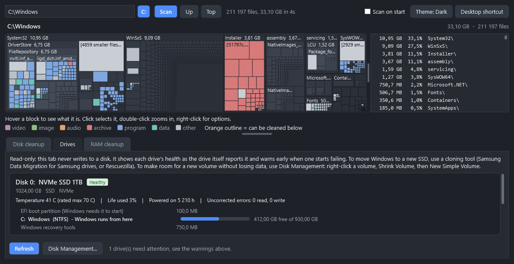

<h1>🧹 DiskTidy</h1>

### A free Windows app that shows what's filling your disk and cleans the junk safely, explaining every item before it deletes anything.

Your drive is full again. Windows says "Temporary files: 24 GB" and offers one big scary **Delete** button. What *are* those files? Will something break? Nobody knows, so nobody clicks.

**DiskTidy shows you what's there, explains it in plain words and lets you pick.** A map of your disk on top, a list of known junk below, and a short note on every line: what it is, why it's there, and what happens if it goes. Then you tick, it cleans. That's the whole idea 😎

<p align="center"><a href="https://github.com/Olexify/DiskTidy/releases/latest"></a></p>

<p align="center"><br><sub>Example data, not a real PC. Your real disk is probably messier. Everyone's is.</sub></p>

<p align="center"><b>Free · no install · no account · no internet, ever · one script · Windows 10 & 11</b></p>

---

## 🚀 Get it running

1. **[Download the latest release](https://github.com/Olexify/DiskTidy/releases/latest)** (`DiskTidy-vX.Y.Z.zip`, about 35 KB. Yes, kilobytes.)
2. Unzip it anywhere.
3. Double-click `DiskTidy.cmd`. Done. 🎉

Optional: click **Desktop shortcut** in the app for a proper icon. Some system folders need admin; the app has a **Restart as admin** button for that.

## 🧽 Disk cleanup: the main event

About 30 places where Windows, browsers, dev tools and apps quietly hoard stuff: Temp folders, crash dumps, npm, pip, uv, Cargo and Go caches, GPU shader caches, browser and desktop-app caches, old Windows Update files and more.

- 🏷️ **Every line explains itself.** Its real location, its size, a **Safe** or **Caution** badge, and a plain note on what happens if you delete it.
- 🌳 **Pick exactly what goes.** Expand any item and its folders appear as a tree with checkboxes. Untick a folder to keep it, or open it and untick just part of it.
- 🧺 **Look-alike folders get bundled.** 48 folders named `render-assets-x7f3…` become one line, not 48.
- 🛡️ **Things worth keeping start unticked**, such as session files of apps you might reopen.
- 🖱️ **Right-click any line** to open it in Explorer or find it on the disk map.

## 🗺️ Disk map: where did 200 GB go?

A treemap of any drive or folder, like WizTree: the bigger the block, the more space it eats.

- 🎨 Files are coloured by type (videos, images, archives, programs and so on), and junk the cleanup list can remove gets an **orange outline**.
- 👆 Hover over a block to outline it and see its path and size. Click to select, double-click to zoom in.
- 🧭 Clickable breadcrumbs at the top jump back to any parent folder. Backspace or the mouse back button go up one level.
- 🐢 It scans only when you press **Scan**, and uses at most half your CPU cores, so your PC doesn't turn into a space heater. Prefer automatic? Switch on **Scan on start**.

## 💽 Drives: is my SSD OK? (read-only)

- ❤️ Health, temperature, SSD life used, power-on hours and errors the drive couldn't fix, for every disk.
- 🚨 Plain warnings when a drive starts dying, like "copy your important files off it now". No SMART jargon.
- 📊 Partitions with free-space bars, including which one Windows lives on.
- 🔧 Buttons for Disk Management and for disk tools you already have, such as Samsung Magician, CrystalDiskInfo or Rescuezilla.
- ✋ It never writes to a disk here. Cloning Windows is a job for a dedicated cloning tool, not a 35 KB script.

## 🧠 RAM cleanup (optional)

- Trims the memory of the apps **you** pick, like Mem Reduct. Nothing closes and no data is lost. The app just reloads its memory when you switch back to it.
- **Clear standby cache** drops cached file data from RAM. It needs admin.
- The honest bit: Windows already does this by itself when RAM runs low. It's handy right before a game or a render, and mostly cosmetic the rest of the time.

## 🛋️ Comfort stuff

- 🌗 Four themes: Light, Dark, Midnight and Sand.
- 🔍 Ctrl + mouse wheel zooms the whole window, and Ctrl+0 resets it.
- ↕️ Drag the dividers to resize the map, its side list and the panel below.
- 💾 Theme, zoom, divider sizes and the list's scroll position are remembered between launches.

## 🛡️ What it will never touch

| 🚫 Off-limits | ✅ How it stays safe |
| :--- | :--- |
| Downloads, Recycle Bin, Documents, Desktop | Skips files changed in the last 2 hours and files an app has open |
| Your projects, Docker, app settings, logins | Never follows junctions or symlinks out of the folder it cleans |
| Anything not on its list | **Caution** items (AI models, IDE indexes, build caches) start unticked |
| | Shows every item and its size, then asks before deleting |

## 🛠️ For developers

The whole app is `DiskTidy.ps1`: WPF in XAML, plus inline C# for the scanner, the treemap layout, the cleaner and RAM trimming, compiled when the app starts. Settings live in `%APPDATA%\DiskTidy\settings.json`.

A built-in self-test checks the treemap maths, cleaning with unticked and part-ticked folders, junction safety, look-alike grouping, drive warnings and RAM info:

```powershell
powershell -ExecutionPolicy Bypass -File DiskTidy.ps1 -SelfTest
```

`-Shot <file.png>` saves a screenshot built from example data only. That's how the picture above was made.

## 📜 License

MIT, see [LICENSE](LICENSE). Use at your own risk: DiskTidy is careful, but it does delete files. That's kind of the point. 🧹
